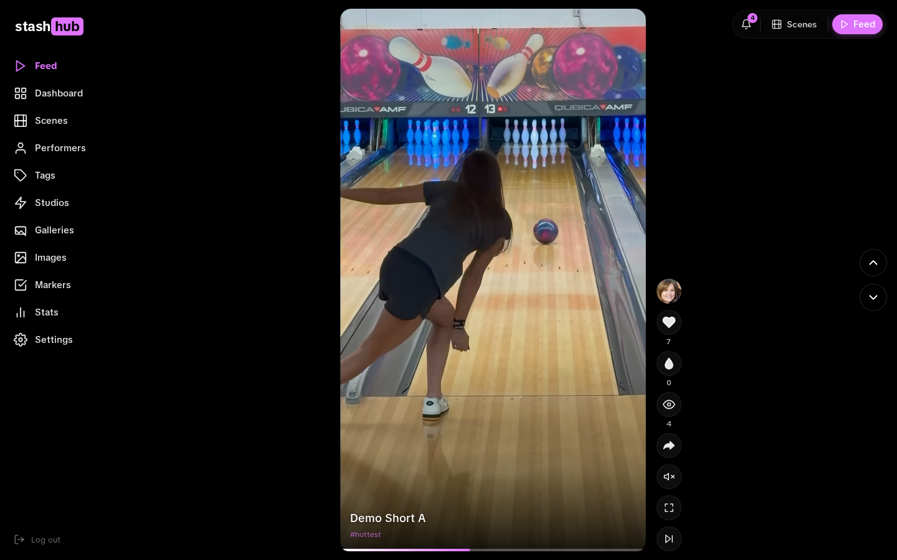

# stashhub

A fork of [Stash](https://github.com/stashapp/stash) with a TikTok-style
vertical feed, a configurable recommendation algorithm, a per-scene like
button persisted to the database, and a dark, modern theme baked into the
binary.

The upstream Stash project does everything stashhub does in terms of
ingestion, scanning, scraping, performer and tag management. stashhub adds a
viewing mode and a few quality-of-life changes on top.

---



## Features at a glance

- 📱 **TikTok-style vertical feed.** Snap-scroll through your library at `/`. Hearts persist to the DB, tap to toggle play, double-tap for fullscreen, arrow keys scroll and seek.
- 🎛️ **Configurable recommendation algorithm.** Five toggleable buckets (hottest, liked, top-rated, stale, random) with per-bucket weights and thresholds. Reshuffles on every Feed open.
- ❤️ **First-class likes.** New `scenes.like_count` column with GraphQL mutations. The heart button on both the Feed and the scene detail page persists to the database; cache updates in place without a refetch.
- 🔔 **Live notification bell.** Top-right counts for new scenes, unorganized scenes, and performers without an image. Refreshes on focus, visibility change, route change, and every 30 s.
- 🧭 **Sidebar replaces the top nav.** Persistent left sidebar with library tabs, logout pinned to the bottom, and a top-right bar for the bell + Scenes / Feed shortcuts.
- 🎨 **Modern dark theme baked into the binary.** Hub-purple accent (`#df73ff`) replaces blueprint blue across cards, scrubber, sliders, dot indicators, and progress strips. No `custom.css` required.
- 🗓️ **Smart date display.** Relative dates ("3 days ago") with the absolute date on hover. Format strings are configurable.
- 🔕 **Toast notice toggles.** The websocket-status toast that fires on every brief network blip is off by default and switchable per type.
- 🔐 **No phone-home.** Update check is unwired, no telemetry, no donate button.

## What it adds

### Feed at `/`

A vertical, snap-scrolling video feed that loads scenes from the library on
demand. Hearts persist to the database, double-tap goes fullscreen, tap
toggles play and pause, arrow keys scroll and seek, the current scene id is
remembered across reloads.

### Configurable recommendation algorithm

Five toggleable buckets, each with its own weight (0 to 10):

| Bucket    | What it returns                                          |
|-----------|----------------------------------------------------------|
| Hottest   | Scenes tagged with a configurable tag                    |
| Liked     | Scenes with `like_count > 0`, ordered by likes desc      |
| Top rated | Scenes with `rating100` at or above a threshold          |
| Stale     | Scenes whose `last_played_at` is older than N days       |
| Random    | Unfiltered random fallback                               |

Weights and thresholds live under Settings, Algorithm. Already-viewed scene
ids are excluded from the queue. The whole queue reshuffles on every Feed
open.

### Likes in the database

Migration 73 adds a `scenes.like_count` column and three GraphQL mutations
(`sceneIncrementLike`, `sceneDecrementLike`, `sceneSetLikeCount`). The Feed
heart button and a new heart button on the scene detail page both call
`sceneIncrementLike`. The Apollo cache is patched in place so the count
updates without a refetch.

### Notification bell

Top-right corner. Shows live counts for:

- Scenes created within a configurable window (default 24 hours)
- Unorganized scenes
- Performers with no `image_path`

Counts refresh on focus, visibility change, route change, and every 30
seconds. Each row links to the filtered list view applied as if the criterion
had been configured manually. Toggleable individually under Settings,
Notifications.

### Sidebar replaces the top nav

Persistent sidebar on the left, logout at the bottom, library tabs in the
middle, logo at the top. The top-right bar holds the notification bell, a
shortcut to Scenes, and a shortcut back to the Feed. The default Stash
top-nav is hidden everywhere.

### Theme

Hub-purple (`--color-hubs: #df73ff`) replaces the Blueprint-blue accent
across cards, progress bars, the scrubber play-progress, slick dots,
sliders, and the watched-progress strip on thumbnails. Blueprint-teal hex
values (`#192127`, `#202b33`, `#394b59`, and so on) are swept out and
replaced with neutral dark variants. All theme rules ship in the binary; no
separate `custom.css` is required.

### Settings tabs added

- **Notifications**: toggle each bell row, set the new-videos window, and
  configure date display (relative dates with an absolute tooltip, plus
  configurable date and date-time format strings)
- **Algorithm**: per-bucket toggles and weights, thresholds, tag picker
- **Notices**: toggle UI toast notices. The websocket-status toast is
  disabled by default since it fires on every brief network blip.

### Other behaviour changes

- `/login` rewritten as a minimal pill-form layout in `ui/login/login.css`
- Modal footer left-aligned, no top border, no top padding
- Settings and Changelog pages flattened, no nested card chrome
- Pagination buttons rendered as compact chevrons
- Toolbar buttons consistent 35px pills, with 23px variants attached to the
  search input
- Tables get soft row dividers instead of borders, empty cells collapse
- Automatic update check disabled

---

## Build

```bash
git clone https://github.com/xoorgz/stashhub.git
cd stashhub

# Build the UI bundle
cd ui/v2.5
yarn install
yarn build
cd ../..

# Build the Go binary (needs Go 1.22 or newer)
make stash
./stash
```

The resulting binary embeds the UI and is the only thing needed to ship. No
`custom.css`, no separate plugin install.

### Configuration

stashhub reads the same `config.yml` as upstream Stash and respects the same
command-line flags (`-c config.yml`, `--port`, `--host`, `--nobrowser`,
`-u ui-location`). First boot writes a default config; everything is
editable from the Settings UI.

### Upgrading from upstream Stash

stashhub is a forward fork from Stash `v0.28.1` plus migration 73. If you
point stashhub at an existing Stash database, it will run the schema
migration on first start (a backup is written next to `config.yml`).
Downgrading back to upstream Stash after running migration 73 is not
supported because the unknown `like_count` column blocks startup.

---

## What is not in the binary

- Anything that talks to upstream stashapp.com servers for telemetry, update
  checks, or analytics. The update endpoint is unwired in the About panel.
- A donate button. Upstream Stash takes donations through Open Collective;
  the fork does not solicit funds.

---

## License

[AGPL-3.0](LICENSE), same as upstream Stash.

Upstream Stash is the project this fork is built on. All credit for the
underlying server, scanner, scraper system, and GraphQL API goes to the
Stash maintainers. The changes in this repository are limited to UI, theme,
the recommendation algorithm, the `like_count` column, and a handful of
settings panels.
